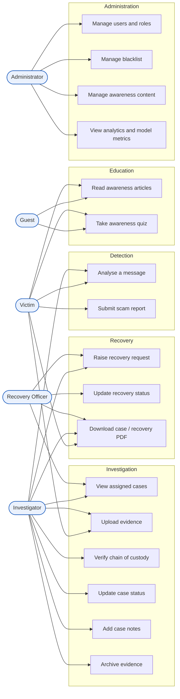
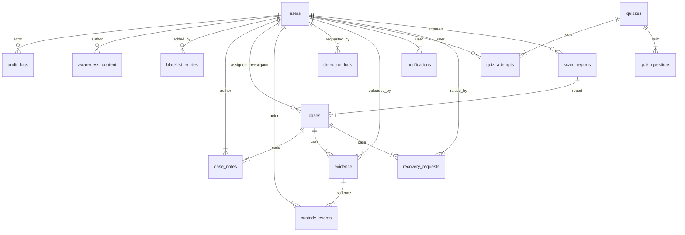
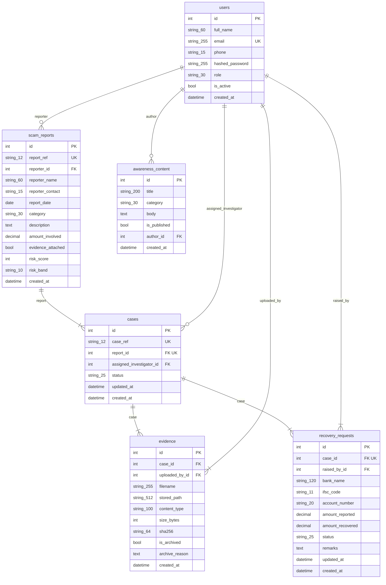
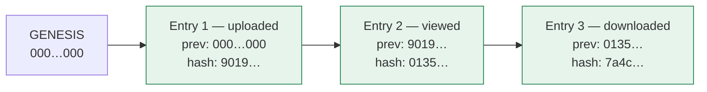
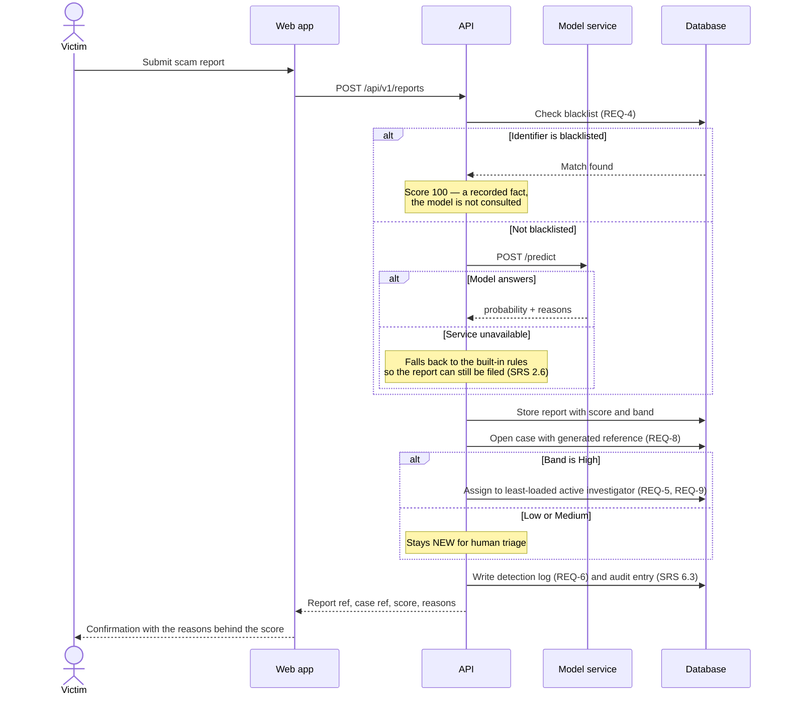
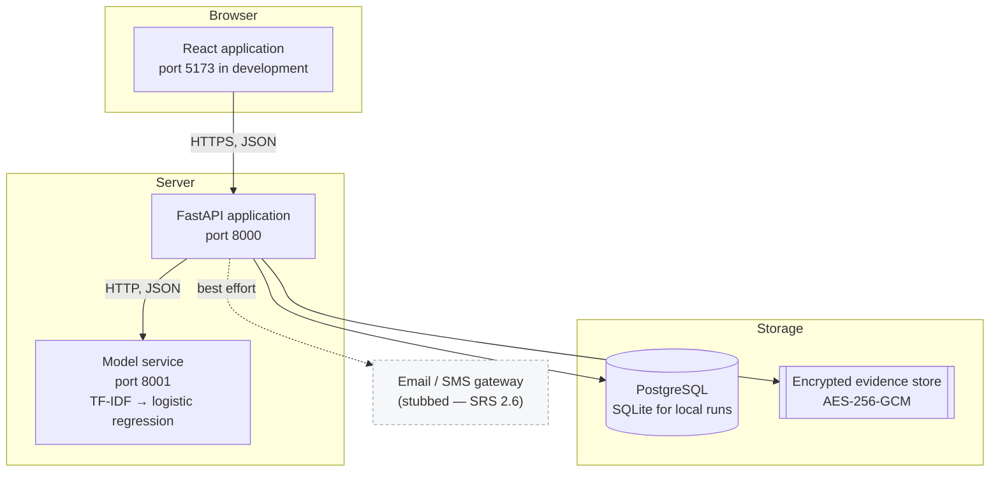

# Design Diagrams

Project ID 35 · UE24CS341A · Team Sentinel Squad

SRS section 4 states that a use-case diagram and a supporting
entity-relationship diagram "are maintained as separate design artifacts and
will be included in the project's design documentation". This is that document.

The entity-relationship diagrams below are **generated from the application's
own models**, not drawn by hand, so they cannot drift away from the schema the
system actually creates. Everything else is drawn to match the routes and roles
that exist in the code.

> GitHub renders the diagrams below directly. If you are reading this in a
> plain text editor, paste a block into <https://mermaid.live> to see it.

---

## 1. Use-case diagram

The five actors of SRS 2.3 and what each may do. Guest is unauthenticated.
Every restriction shown here is enforced on the server, not by hiding buttons.



**Two things the diagram is deliberately strict about.**

A victim appears against *Upload evidence* and *Download PDF* only for their own
case; an investigator only for a case assigned to them. The diagram cannot show
that qualifier, so it is stated here: ownership is checked on every request, and
there are tests that call each endpoint as the wrong role and require a refusal.

*Update recovery status* belongs to the recovery officer and the administrator,
not the investigator. Recording that money moved is a statement about what a
bank did, and it belongs to whoever is liaising with the bank.

---

## 2. Entity-relationship overview

All 15 tables and the relationships between them.
Attributes are omitted here for legibility; the six entities named in SRS
section 4 are shown in full in section 3.



Read `||--|{` as "one to many, required" and `||--o{` as "one to many,
optional". `users` sits at the centre because almost every record names the
person responsible for it, which is what makes the audit trail in SRS 6.3
possible.

---

## 3. Core entities in detail

The six entities SRS section 4 names: User, Report, Case, Evidence,
RecoveryRequest and AwarenessContent.



Notes that matter when reading this:

- `scam_reports.report_ref` and `cases.case_ref` are the 12-character
  human-facing references from SRS Appendix B. The integer `id` columns are
  internal and never shown to a user.
- `evidence.stored_path` is recorded **relative to the evidence root**, not as
  an absolute path. An absolute path would pin the database to one machine and
  one folder, and moving either would orphan every file.
- `evidence.sha256` is the digest of the *plaintext*, so it stays comparable
  with a hash the submitter or a court computes from the original file.
- `recovery_requests.amount_reported` of 0 means "not stated" rather than
  "nothing was lost", because SRS Appendix B makes the amount optional.

---

## 4. Full table reference

| Table | Columns | Purpose |
|---|---|---|
| `audit_logs` | 6 | Security-relevant actions: logins, evidence access, status changes (SRS 6.3). |
| `awareness_content` | 7 | Public awareness articles (REQ-20). |
| `blacklist_entries` | 6 | Known fraudulent URLs, numbers and UPI IDs (REQ-4, REQ-25). |
| `case_notes` | 5 | Attributed, timestamped investigator notes (REQ-14). |
| `cases` | 7 | The investigation record opened for a report (REQ-8). |
| `custody_events` | 8 | The hash-chained chain of custody (REQ-11). |
| `detection_logs` | 9 | Every risk-scoring request and its result (REQ-6). |
| `evidence` | 11 | Uploaded files, encrypted at rest, never deleted (REQ-10, REQ-13). |
| `notifications` | 7 | Status-change notices to victims, stored before dispatch (REQ-18). |
| `quiz_attempts` | 6 | Scored attempts, for the analytics in REQ-24. |
| `quiz_questions` | 6 | Questions and options; the answer key never leaves the server. |
| `quizzes` | 5 | Awareness quizzes (REQ-21). |
| `recovery_requests` | 12 | Fund-recovery tracking against a case (REQ-15 to REQ-19). |
| `scam_reports` | 13 | One submission by a victim. Field lengths follow SRS Appendix B. |
| `users` | 8 | Every account, with the role that governs what it may do. |

---

## 5. The chain of custody

The one part of the data model that is not an ordinary table. REQ-11 requires
evidence handling to be immutable; a normal audit table is one `UPDATE` away
from being rewritten, and nothing about the table would reveal it.

Each custody entry contains a SHA-256 digest computed over its own contents
**together with the previous entry's digest**. Altering or deleting any
historical entry therefore breaks verification at that link and at every link
after it.



If entry 2 is edited directly in the database, its recomputed digest no longer
matches the stored one, and entry 3's `prev` no longer matches entry 2 either.
Verification reports the first broken link by id. Two separate facts are
checked: whether the *log* was rewritten, and whether the *file* behind it was
swapped — a file can be replaced without touching the log, and the digest
catches that independently.

---

## 6. How a report moves through the system

The sequence that joins the four modules. Everything after step 4 depends on the
risk band decided in step 3.



---

## 7. Deployment view

Three services, as SRS 3.2 requires: the model is separately deployable so it
can be retrained or replaced without touching the application.



The dashed link is deliberate. Notifications are written to the database before
dispatch and dispatch failures are swallowed, because SRS 2.6 requires gateway
unavailability to degrade notifications rather than break the system. The same
reasoning applies to the model service: the API starts and serves whether or not
it is reachable.

---

## Regenerating this document

The diagrams in sections 2, 3 and 4 come from the application's models. After
changing a model, regenerate rather than editing by hand:

```
backend\.venv\Scripts\python.exe docs\gen_diagrams.py
```
